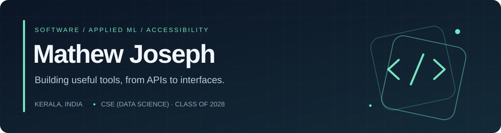

  

I build backend systems and ML-powered tools, often around speech and accessibility.

CSE (Data Science) at **MACE**, class of 2028. Software Developer Trainee at **ALLTechSoft**.

### Things I've built

- **[CueBell](https://github.com/mathew1046/CueBell)** · Personal alerts for spoken announcements, on Android and the web.
- **[Brightloop](https://github.com/mathew1046/subscription-management-system)** · Self-hosted subscription management with Go, Next.js and PostgreSQL.
- **[GloveTalk](https://github.com/mathew1046/Sign2Sound_Kaizen)** · Sign recognition using computer vision and a sensor glove.
- **[KaiSign](https://github.com/mathew1046/KaiSign)** · An ordering-kiosk prototype with voice and supported sign inputs.
- **[JobSathi](https://github.com/mathew1046/jobsathi)** · A voice-driven resume builder for Indian languages.

Also exploring compiler internals through [LLVM/Clang pull requests](https://github.com/llvm/llvm-project/pulls?q=is%3Apr+author%3Amathew1046).

---

[LinkedIn](https://www.linkedin.com/in/0xmathew/) · [Email](mailto:mathewjosephparakka@gmail.com)  
Open to software engineering and applied ML internships.
