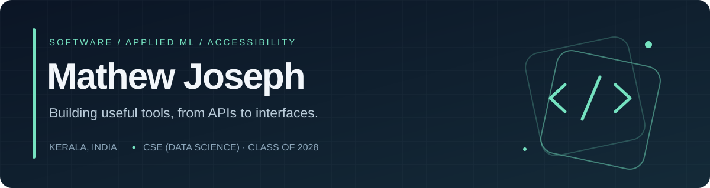

  

  Software Developer Trainee @ <b>ALLTechSoft</b> · CSE (Data Science) @ <b>MACE</b> 
  <a href="https://www.linkedin.com/in/0xmathew/">LinkedIn</a> ·
  <a href="mailto:mathewjosephparakka@gmail.com">Email</a>

### Selected work

| Project | What it does |
| :--- | :--- |
| [Brightloop](https://github.com/mathew1046/subscription-management-system) | Self-hosted subscription billing · Go, PostgreSQL |
| [CueBell](https://github.com/mathew1046/CueBell) | Announcement alerts for Android · Kotlin, FastAPI |
| [GloveTalk](https://github.com/mathew1046/Sign2Sound_Kaizen) | Sign recognition with vision and wearables · PyTorch, ESP32 |
| [JobSathi](https://github.com/mathew1046/jobsathi) | Voice-driven resume builder · React, FastAPI |
| [KaiSign](https://github.com/mathew1046/KaiSign) | Accessible ordering kiosk · MediaPipe, FastAPI |

**Open source:** [LLVM/Clang pull requests](https://github.com/llvm/llvm-project/pulls?q=is%3Apr+author%3Amathew1046)

Open to software engineering and applied ML internships.
